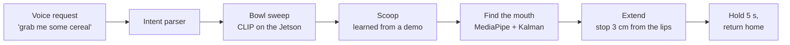

# Assistive Feeding Robot

**Ask for food. It scoops a bite and brings it to your mouth.**

**People's Choice Award** at the 3% Club Civic AI Hackathon (NYC, Oct 23–25, 2026), in the
*Physical AI for Good* track sponsored by [Viam](https://www.viam.com/). Built in one weekend by
Kurt Lin, Sunny Li and Safal Ghimire (NYU Robotics Team) on a low-cost, 3D-printed SO-101 arm.


## Demo

[](https://youtu.be/ueZ0i9V6slo)

**[Watch the demo on YouTube](https://youtu.be/ueZ0i9V6slo)**

## Why we built it

Some people can't lift a spoon to their mouth, for example after a stroke or a spinal cord injury,
or with ALS. Being fed at every meal costs independence, and it costs a caregiver's time.
This robot lets the person choose what to eat and when, using only their voice.

**How to use it:** sit facing the arm, say *"Grab me some cereal"*, then open up and take your
bite. Say **"stop"** at any time to stop the arm.

## How it works



<table>
  <tr>
    <td width="33%"><br><b>Computer vision identifies each bowl.</b> It still finds the right food if the bowls are swapped.</td>
    <td width="33%"><br><b>The camera finds your mouth</b> and keeps the spoon level while it centres on your lips.</td>
    <td width="33%"><br><b>It stops 3 cm from your lips.</b> You close the gap and take the bite.</td>
  </tr>
</table>

## Tech stack and models

| Component | What it does | Models and tech | Runs on |
|---|---|---|---|
| **Voice in and out** | Hears the request. Speaks each step ("Checking Bowl 1", "Take a bite"). | Web Speech API (`SpeechRecognition`, `speechSynthesis`). An operator safety button arms hands-free listening. | Browser |
| **Language understanding** | Turns phrases like "could you bring me some M&Ms?" into a validated robot command. Stop words always win. | Rule-based intent parser (JavaScript), with 26 tests | Browser |
| **Food recognition** | Labels what's in each bowl: cereal, M&Ms, or empty. | **OpenAI CLIP ViT-B/32** (`openai/clip-vit-base-patch32`) via Hugging Face Transformers and PyTorch, FP16 on CUDA. Uses zero-shot prompt ensembles plus a few enrolled example photos, packaged as a custom Viam vision-service module. | NVIDIA Jetson Orin GPU |
| **Bowl positions** | Knows where each bowl is and draws its outline on the video. | Viam frame system and 3D scene. Camera pose comes from forward kinematics; bowls are calibrated by touching them with the spoon tip. | Laptop |
| **Face and mouth tracking** | Finds the lips and predicts their motion at 30 fps. | **Google MediaPipe Face Landmarker** (478 landmarks) plus a Kalman filter. Metric distance comes from the eye spacing. | Laptop CPU |
| **Depth** | Measures the distance to the lips; feeds a live depth view. | **Apple Depth Pro** (monocular metric depth) in a custom Viam camera module. Depth Anything 3 (metric) is available as an alternative. | Cloud GPU (NVIDIA H200 via Brev); view rendered on the Jetson |
| **Arm control** | Centres the spoon on the lips and reaches toward the face smoothly. | Custom SO-101 kinematics. A damped-least-squares tracker that respects joint limits, 60 Hz minimum-jerk trajectories, servo-sag compensation, and streamed joint setpoints. | Laptop, to the arm through Viam |
| **Scooping** | Picks up a bite without spilling. | Learning from demonstration: one hand-guided scoop is recorded at 30 Hz, smoothed, and retargeted to each bowl, with rim and floor clearance checks. | Laptop |
| **Robot platform** | Hardware drivers, configuration, the modules above. | Viam RDK (`viam-server`), Viam Python SDK, SO-101 arm module | Jetson Orin |
| **Operator dashboard** | Live camera and depth, voice input, progress, debug controls, STOP. | Python HTTP server with MJPEG streaming and OpenCV overlays. Web UI in HTML, CSS and JavaScript. | Laptop and browser |

**Safety:** STOP always wins. The spoon never comes closer than 3 cm to the lips, motion slows
near the face, and voice control works only after an operator presses a safety button.

## Hardware


- **SO-101 arm:** low-cost and 3D-printed, with a spoon held in the gripper.
- **Logitech C270 webcam** on the wrist; it sees both the bowls and the face.
- **NVIDIA Jetson Orin:** runs `viam-server` and CLIP on-device.
- **Laptop:** runs face tracking, control and the dashboard.
- **Cloud GPU (NVIDIA H200):** runs the depth model, so the Jetson stays cool.

<br clear="right">

## Team


**Kurt Lin · Sunny Li · Safal Ghimire**, NYU students on the same robotics team.

## Run it

```bash
make setup                                                 # Python 3.12 venv
dashboard/run_mac.sh --token <token> --allow-extend        # dashboard on http://localhost:8090
```

Hardware setup: [docs/SO101_SETUP.md](docs/SO101_SETUP.md). Dashboard guide:
[dashboard/README.md](dashboard/README.md). The original plan, safety framing and package map:
[docs/ENGINEERING_OVERVIEW.md](docs/ENGINEERING_OVERVIEW.md).
