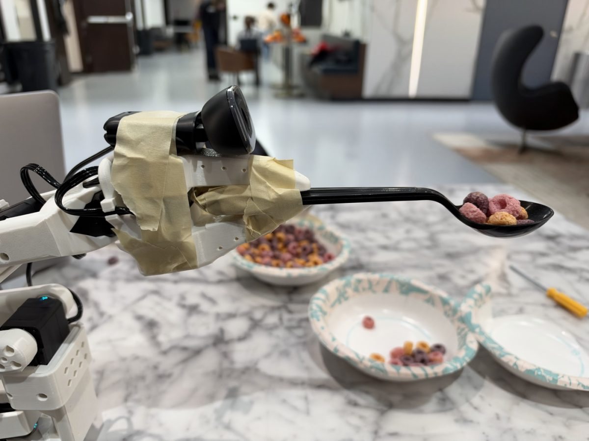
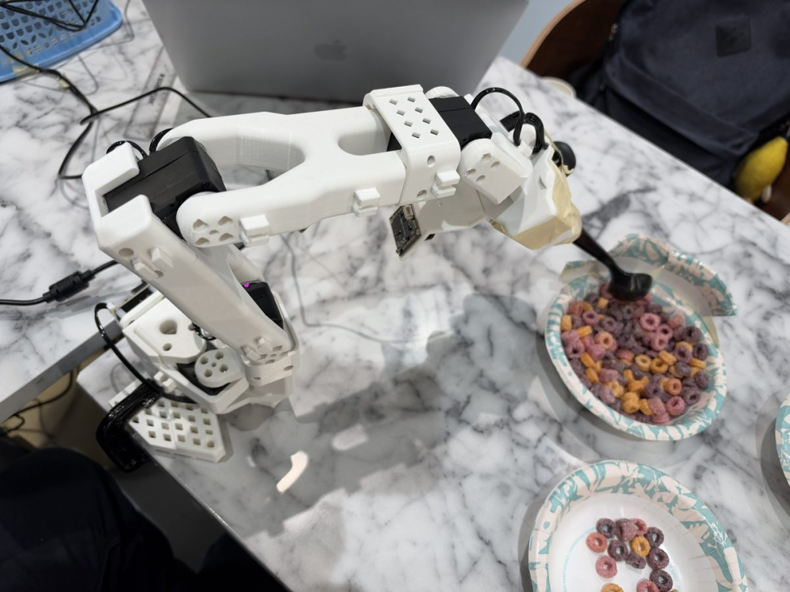
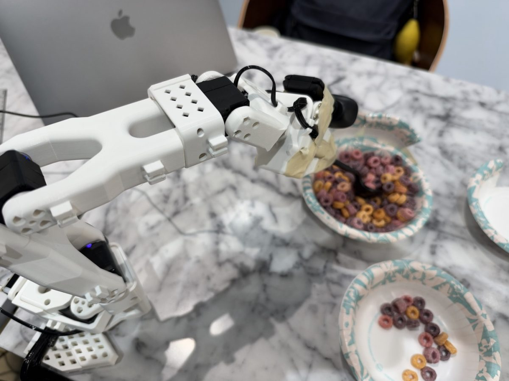

# Assistive Feeding Arm

**A voice-controlled robot arm that feeds a person: it finds the food you ask for, scoops it,
and brings the spoon to your mouth.**

**People's Choice Award** at the 3% Club Civic AI Hackathon (NYC, Oct 23–25, 2026), in the
*Physical AI for Good* track sponsored by [Viam](https://www.viam.com/). Built in one weekend on
a low-cost SO-101 arm.



## Demo

<!-- Paste the demo video link here, e.g. [](https://youtu.be/...) -->
**Video:** *coming soon*

## Why

Many people can't feed themselves, for example after a stroke or a spinal cord injury, or with ALS.
Being fed at every meal costs independence, and it costs a caregiver's time. This arm lets the
person decide what to eat and when, using only their voice.

## What it does

1. **Listens.** The person says, for example, "grab me some cereal" or "could you bring me some
   M&Ms?", and a language layer turns it into a request.
2. **Finds the food.** The wrist camera looks into each bowl, and a CLIP model running on the
   **NVIDIA Jetson Orin** labels what's inside. It still works if the bowls are swapped.
3. **Scoops.** It replays a scoop the team taught it by guiding the arm by hand, refitted to the
   chosen bowl's measured position. The spoon goes in slowly so the food stays on.
4. **Feeds.** It turns to the person, tracks their face at 30 fps (MediaPipe), and brings the
   spoon level to the mouth. It stops **3 cm short of the lips** and holds while the person eats.
5. **Returns home** and says what it's doing at every step.

<p>
  
  
</p>

## Engineering highlights

- **Control:** a damped-least-squares tracker keeps the spoon level while centring on the lips.
  It handles joint limits and compensates for servo sag, and moves are smoothed with minimum-jerk
  trajectories.
- **Perception split across devices:** face tracking runs on the laptop. Bowl recognition (CLIP)
  runs on the Jetson's GPU as a Viam module. Monocular depth (Apple Depth Pro) runs on a cloud
  GPU, so the Jetson stays cool.
- **Learning from demonstration:** one hand-guided scoop is recorded, smoothed, and retargeted
  to each calibrated bowl. Safety checks stop the spoon from hitting the bowl's rim or floor.
- **Safety first:** STOP always wins. A 3 cm standoff from the lips is enforced, motion slows
  near the face, and an operator must press a safety button before voice control is armed.
- **Operator dashboard:** live camera and depth views, voice and text input, spoken narration,
  step-by-step progress, and debug controls.

**Stack:** Python, Viam (robotics platform), SO-101 arm (LeRobot), NVIDIA Jetson Orin, MediaPipe,
OpenAI CLIP, Apple Depth Pro, NumPy, OpenCV, and a JavaScript web UI using the Web Speech API.

## Team

Safal Ghimire, Yucan (Sunny) Li and Josiah: NYU RoboMaster controls leads, who moved from
aiming at armor plates to aiming a spoon, gently.

## Run it

```bash
make setup                                                 # Python 3.12 venv
dashboard/run_mac.sh --token <token> --allow-extend        # dashboard on http://localhost:8090
```

Hardware setup is in [docs/SO101_SETUP.md](docs/SO101_SETUP.md) and the dashboard guide in
[dashboard/README.md](dashboard/README.md). The original plan, safety framing and package map are
in [docs/ENGINEERING_OVERVIEW.md](docs/ENGINEERING_OVERVIEW.md).
