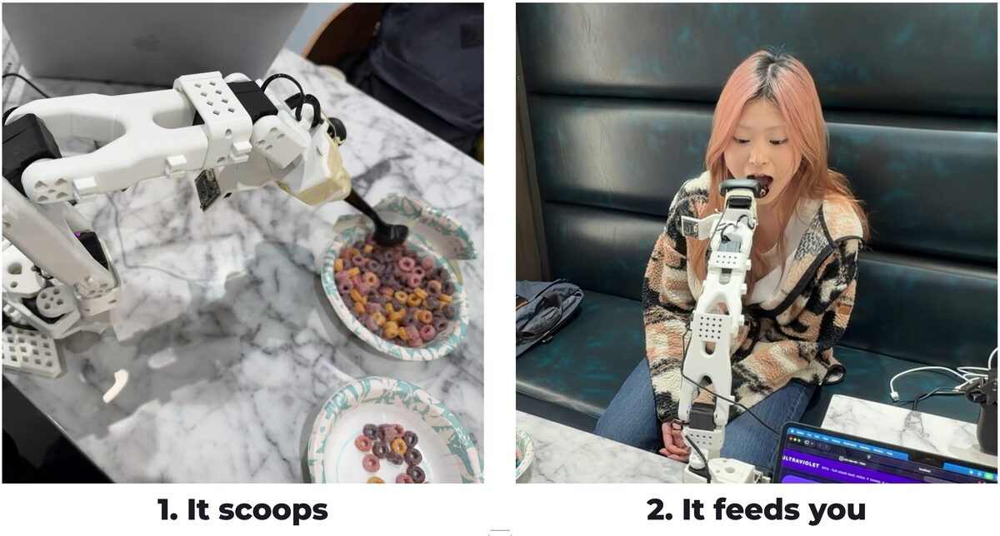
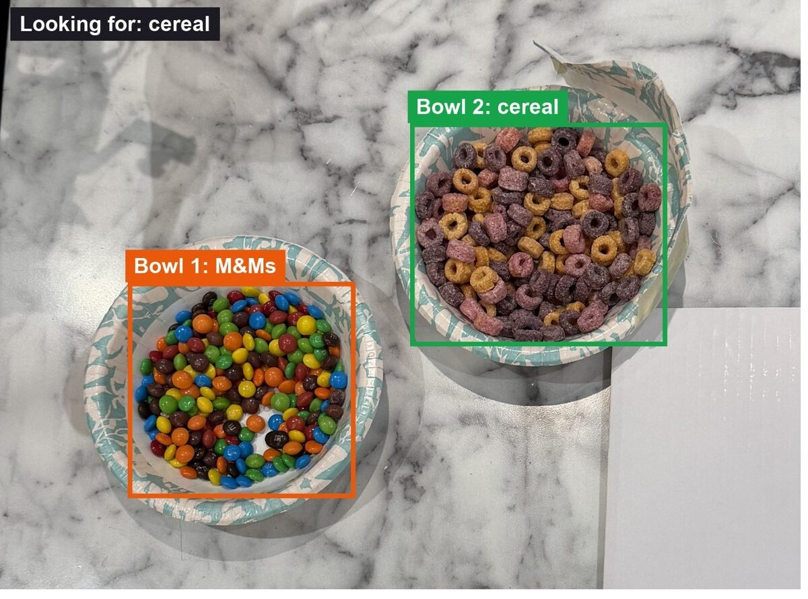
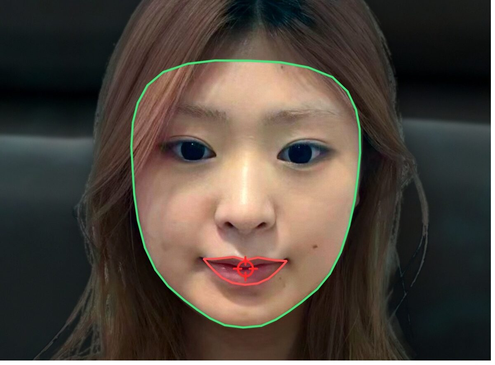
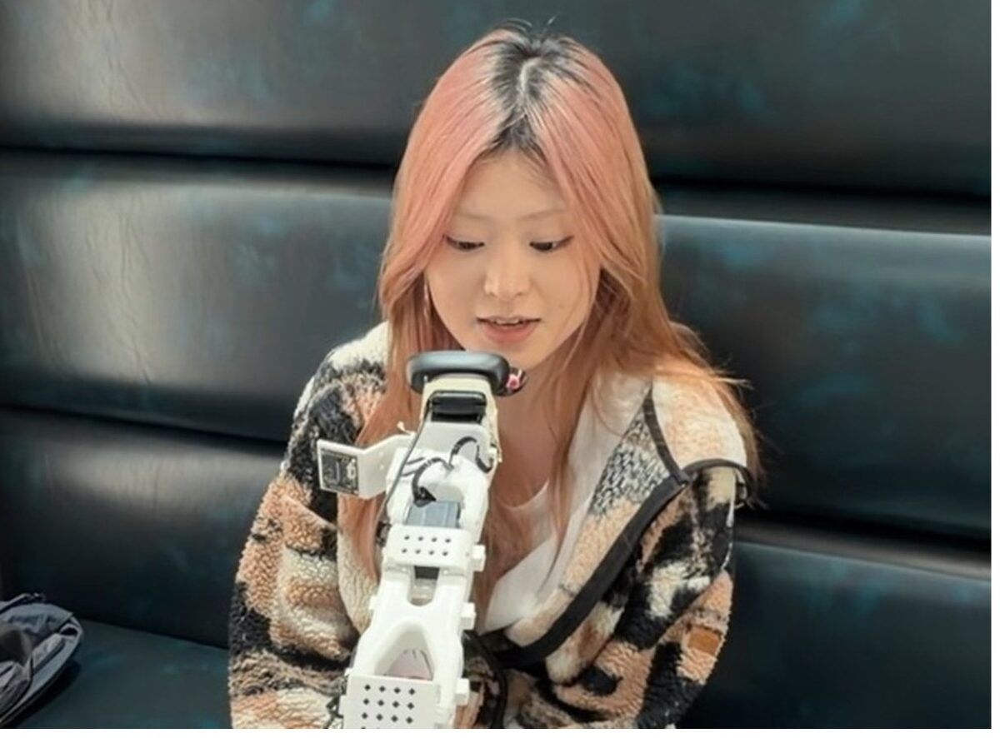
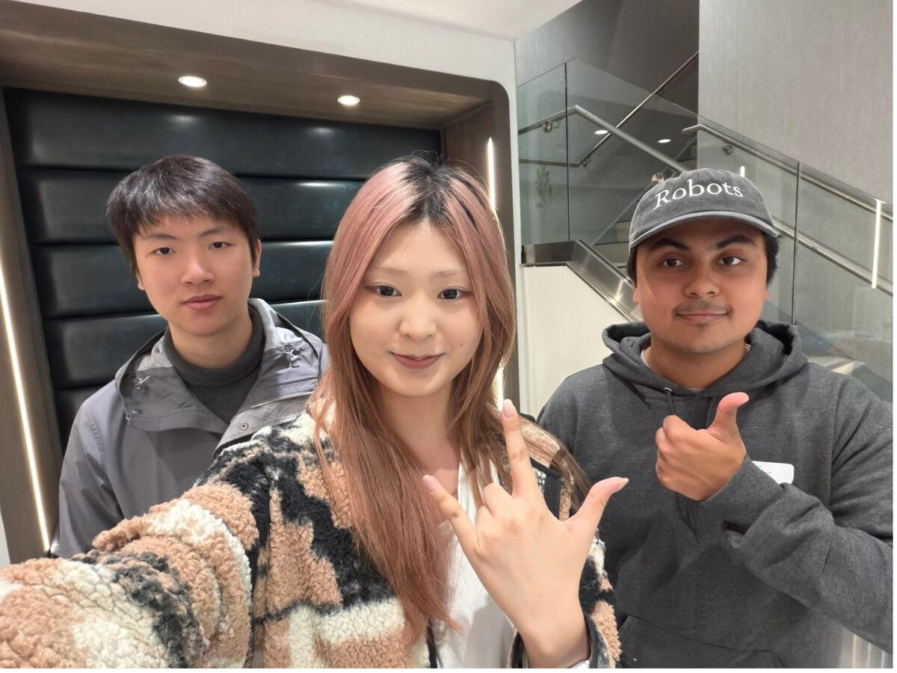
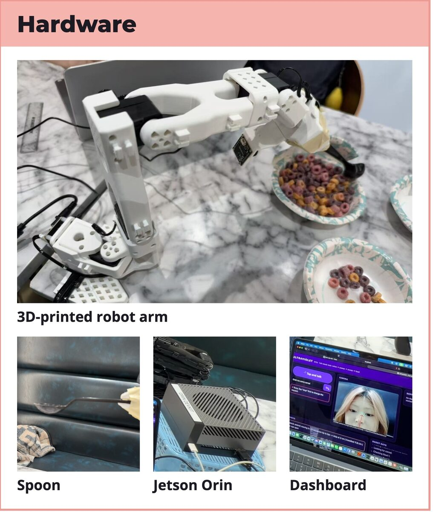

# Assistive Feeding Robot

**Ask for food. It scoops a bite and brings it to your mouth.**

**Winner of the People's Choice Award** at the 3% Club Civic AI Hackathon (NYC, October 2026),
in the *Physical AI for Good* track sponsored by [Viam](https://www.viam.com/).
Built in one weekend by Kurt Lin, Sunny Li and Safal Ghimire.

[](https://youtu.be/ueZ0i9V6slo)

**[Watch the demo on YouTube](https://youtu.be/ueZ0i9V6slo)**

**In short:** a voice-controlled assistive feeding system on a 3D-printed, 5-DOF **SO-101 robotic arm**,
built in **Python** on the **Viam** robotics platform with an **NVIDIA Jetson Orin**. It combines
**computer vision** (OpenAI **CLIP** in **PyTorch** to recognise food, Google **MediaPipe** face tracking
with a **Kalman filter**, **OpenCV**) with real-time **motion control**: inverse kinematics that keeps the
spoon level, smooth trajectories, and a scoop learned from a human demonstration. People talk to it through
a **JavaScript** web app that uses speech recognition and text-to-speech.

## Why

Some people can't lift a spoon to their mouth, for example after a stroke or with ALS.
This robot helps them eat on their own, at their own pace, using only their voice.

## How it works



1. **You ask:** "Grab me some cereal." (speech recognition in the browser)
2. **It looks into each bowl** to find the food you asked for, using an AI vision model (CLIP) on the Jetson.
3. **It scoops a bite,** the way we taught it by guiding the arm by hand (learning from demonstration).
4. **It finds your mouth** with its camera (MediaPipe face tracking) and brings the spoon to you.
5. **It stops 3 cm from your lips,** waits while you eat, then goes back.

Say **"stop"** at any time and the arm stops.

<table>
  <tr>
    <td width="33%"><br>It knows which bowl holds what.</td>
    <td width="33%"><br>It finds your mouth.</td>
    <td width="33%"><br>It stops just short of your lips.</td>
  </tr>
</table>

## The team



**Kurt Lin · Sunny Li · Safal Ghimire**, NYU students on the same robotics team.

---

<details>
<summary><b>For engineers: how it's built (tech stack, models, hardware)</b></summary>

### Pipeline


### Tech stack and models

| Component | Models and tech | Runs on |
|---|---|---|
| Voice in and out | Web Speech API (speech recognition and synthesis). An operator safety button arms hands-free listening. | Browser |
| Language understanding | Rule-based intent parser (JavaScript, 26 tests). Stop words always win. | Browser |
| Food recognition | OpenAI CLIP ViT-B/32 (`openai/clip-vit-base-patch32`), Hugging Face Transformers and PyTorch, FP16 on CUDA. Zero-shot prompt ensembles plus a few enrolled example photos, packaged as a custom Viam vision-service module. | NVIDIA Jetson Orin GPU |
| Bowl positions | Viam frame system and 3D scene; camera pose from forward kinematics; bowls calibrated by touching them with the spoon tip. | Laptop |
| Face and mouth tracking | Google MediaPipe Face Landmarker (478 landmarks) plus a Kalman filter. Distance estimated from eye spacing. | Laptop CPU, 30 fps |
| Arm control | Custom SO-101 kinematics; inverse-kinematics tracking that keeps the spoon level within joint limits; smooth 60 Hz trajectories; compensation for servo sag. | Laptop, to the arm through Viam |
| Scooping | Learning from demonstration: one hand-guided scoop recorded at 30 Hz, smoothed, and retargeted to each bowl with rim and floor clearance checks. | Laptop |
| Robot platform | Viam RDK (`viam-server`), Viam Python SDK, SO-101 arm module | Jetson Orin |
| Operator dashboard | Python HTTP server, MJPEG video, OpenCV overlays; HTML, CSS and JavaScript web UI. | Laptop and browser |

**Safety:** STOP always wins. The spoon never comes closer than 3 cm to the lips, motion slows
near the face, and voice control works only after an operator presses a safety button.

### Hardware



- **SO-101 robotic arm:** low-cost, 3D-printed, 5-DOF plus a gripper holding the spoon.
- **Logitech C270 webcam** on the wrist.
- **NVIDIA Jetson Orin** for the robot software and the CLIP model.
- **Laptop** for face tracking, control and the dashboard.

### Run it

```bash
make setup                                                 # Python 3.12 venv
dashboard/run_mac.sh --token <token> --allow-extend        # dashboard on http://localhost:8090
```

More: [hardware setup](docs/SO101_SETUP.md) · [dashboard guide](dashboard/README.md) ·
[original plan and safety framing](docs/ENGINEERING_OVERVIEW.md)

</details>
